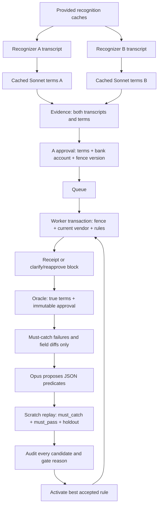

# tellr

Voice payment receipts that must still match the caller’s authorization when they commit.

## What it does

- Store two recognizers’ transcripts and extracted payment terms as evidence.
- Approve from recognizer A with an immutable bank-account snapshot.
- Check deterministic rules inside a fenced MongoDB transaction before writing a receipt.
- Label receipts against independent truth and approval with an oracle.
- Let Claude propose rules; replay gates reject fixes that block good payments or worsen holdouts.

Payments are MongoDB receipts, not money transfers. This Python 3.11 portfolio
project started at the MongoDB x Cerebral Valley harness hackathon; no submission
or award is claimed.

## Quickstart: cached results, no API keys

From a fresh clone, with [uv](https://docs.astral.sh/uv/) installed:

```sh
uv sync --frozen --python 3.11
uv run python scoreboard.py --artifact artifacts/failure_hunt_experiment.json
uv run pytest -q -m 'not integration'
```

This prints the saved measured scoreboard and runs unit checks. It requires no
MongoDB, speech model, recordings to regenerate, or API keys. The fixture pipeline
and full transaction tests use local MongoDB; commands are below.

## Measured comparison

The current hunt uses **180 synthetic payment clips plus 33 confirmation clips**:
ElevenLabs stock voices Roger, Charlie and Alice, two speech speeds, and clean
or simulated phone channels. Generated audio is attributed to
[ElevenLabs](https://elevenlabs.io), using `eleven_flash_v2_5`. Cached Scribe v2
(recognizer A), local faster-whisper small (B), and Sonnet 4.6 terms are frozen
inputs. The comparison ran the real worker/oracle and live Opus 5.5 proposer on
Atlas; it made no new TTS, STT or extraction requests.

Twelve spoken account-13 requests are absent from the vendor file and are
explicitly excluded, expected=clarify. All 180 attempts remain in the export.
The eligible 168 cases comprise **must_catch 12**, **must_pass 100**, and
**holdout 56**. Roger/Charlie supply training and benign cases. Alice is a
voice never shown to the proposer, but used by the gate. Seven missing-A
instructions stay as intake
clarification outcomes; B never supplies their approval. All policies use the
same suites and approve from A.

| Policy | Unsafe caught | Correct payments blocked | Unsafe remaining |
|---|---:|---:|---:|
| No rules | 0/23 | 0/138 | 23 |
| Recognizer agreement | 22/23 | 42/138 | 1 |
| Account-on-file | 22/23 | 0/138 | 1 |
| Learned rule (live Opus) | 22/23 | 0/138 | 1 |

The agreement comparator fails the replay gate because it blocks correct
payments. The account rule passes. Opus proposed two account-check candidates
in one iteration; both passed, and the shorter activated. It checks that A's
spoken destination matches the vendor account, otherwise requesting clarification.
The other candidate stays accepted/inactive; no rejection was invented.

The remaining Alice holdout says **fourteen**, but both recognizers/extractions
produce **$40**. Its permitted rule fields equal those of 12 correct $40 cases.
This rule language cannot separate them without false blocks. `healed` means
training failures are gone, not that holdouts are all safe.

These inputs were selected by an iterative search using stock TTS voices and
simulated channels. The split withholds a voice, not phrases; designers already
saw all voices, and holdouts participate in gating. The counts are not deployment
error rates. **All 705 original hunt source/channel/cache files are retained**
(30,974,242 bytes), linked by the verified manifest. Original channels used
absolute-path noise seeds; future hashes use repo-relative paths. Keeping exact
bytes avoids claiming portable reconstruction of the original experiment.

[RESULTS.md](RESULTS.md) has per-set scores, candidate decisions, measured timing
and the separate confirmation finding: Whisper turned a refusal into “Thank you
very much,” which Sonnet labeled UNCLEAR. Confirmation labels did not enter the
payment rule experiment. [failure_hunt_experiment.json](artifacts/failure_hunt_experiment.json)
contains every supplied attempt and comparator outcome, including exclusions.

Replay or inspect from the repository root:

```sh
# Cached classification only: no API key or speech model needed.
uv run python -m experiments.failure_hunt.rescore
uv run python -m experiments.failure_hunt.confirm_score
# Real Atlas transactions and live Opus proposals; reads ignored env files.
uv run python -m experiments.failure_hunt.compare
# Saved results only: no MongoDB or API access.
uv run python scoreboard.py --artifact artifacts/failure_hunt_experiment.json
uv run python scoreboard.py --artifact artifacts/failure_hunt_experiment.json --json
```

Hunt API keys come only through `experiments/failure_hunt/keys.py`, from ignored
`.env`/`.env.secrets`. Compare seeds Atlas and owns a fresh audit database; each
scratch replay is cleaned up. Pass `--output` to preserve an additional run.
Details, provenance and optional acquisition commands are in
[experiments/failure_hunt/README.md](experiments/failure_hunt/README.md).

## Sealed evaluation: frozen rule, no gate decision

Alice is a **voice never shown to the proposer, but used by the gate**. Sealed
voices have **no part in search, proposal, or gate**. The finished Bill test
reused fixed phrases/channels with a fresh stock voice; its saved learned rule
was evaluated through the real worker/oracle on Atlas without tuning or selection.

| Bill: 55 correct payment candidates | Correct payments blocked | Unsafe commits |
|---|---:|---:|
| No rules | 0/55 | 0 |
| Recognizer agreement | 5/55 | 0 |
| Frozen learned rule | 0/55 | 0 |

All 60 clips are retained: four off-file requests are excluded, and one of the
56 on-file clips yields intake clarification. Scribe’s 55 complete on-file
payment extractions were correct. With no unsafe baseline payment, this tests
false blocking, not unsafe-payment recall. [RESULTS.md](RESULTS.md) and the
[sealed export](artifacts/sealed_bill_experiment.json) contain the measured outcomes.

In the original hunt, complete on-file Scribe/Sonnet terms produced errors on
Charlie (Australian stock voice) **12/54**, Alice (British stock voice) **11/54**,
and Roger (US stock voice) **0/53**. These are synthetic voices, a small selected
sample, and **not accent error rates**.

To repeat the frozen Atlas evaluation using cached inputs and an ignored URI:

```sh
uv run python -m experiments.failure_hunt.sealed_score
uv run python -m experiments.failure_hunt.sealed_eval --policy-artifact artifacts/failure_hunt_experiment.json --output artifacts/sealed_bill_replay.json
```

The first command is offline; the second makes real Atlas transactions. It pins
policy/source hashes, owns and drops scratch databases, and makes no proposer,
STT, or extraction requests. The sealed results cannot accept or activate a rule.

## Earlier six-recording experiment


Six supplied recordings were processed with ElevenLabs Scribe v2 (`no_verbatim=false` and `true`) and independent Claude Sonnet 4.6 extraction. **No extracted money terms diverged between modes.** Cleanup retained the amount and account corrections. All extracted terms matched the speaker-confirmed labels, including spoken account suffixes and “today” resolved to recording date 2026-10-11. This experiment did not reproduce cleanup losing a payment correction.

The baseline still failed when a vendor’s account changed after approval. A live Opus 5.5 proposal learned an account-identity rule that caught that scenario while preserving benign edits. A separate, explicitly synthetic stress suite exercised deliberately lossy transcripts. These are separate results, not additional real Scribe failures.

Scores below are **ok / unsafe_commit / benign_block**; duplicates were zero. Source: [RESULTS.md](RESULTS.md).

| Suite | Set | N | Baseline | Final |
|---|---|---:|---|---|
| Measured recordings + edits | must_catch | 1 | 0 / 1 / 0 | 1 / 0 / 0 |
| Measured recordings + edits | must_pass | 8 | 8 / 0 / 0 | 8 / 0 / 0 |
| Measured suite, synthetic holdouts | holdout | 5 | 2 / 3 / 0 | 3 / 2 / 0 |
| Synthetic stress | must_catch | 4 | 0 / 4 / 0 | 4 / 0 / 0 |
| Synthetic stress | must_pass | 5 | 5 / 0 / 0 | 5 / 0 / 0 |
| Synthetic stress | holdout | 5 | 2 / 3 / 0 | 5 / 0 / 0 |

Measured healing took one iteration; synthetic stress took two. **Two synthetic holdouts remain unsafe in the measured-suite policy.** Its training data contained no transcript divergence from which to learn the clarification rule. The healer’s `healed` status means must-catch failures are resolved, not that all holdouts pass. Six recordings and these small, labeled scenario sets do not establish production error rates or generalization.

## Pipeline and healing loop

The hunt path below uses frozen A/B evidence and A approval. The earlier pipeline
also supports dual Scribe modes and cleaned approval; both share the same worker,
oracle and replay gates.



The worker atomically claims one pending queue item. One transaction increments the vendor fence, reads current vendor/evidence/intent/rules, and records either an idempotent receipt or a block. Bank-account updates increment the same fence in their transaction, causing conflicting payments to retry and reread coherent state. Fence versions also change for harmless name or memo edits: version equality alone is not an account-identity check. The naive empty-rules baseline intentionally pays the current bank account; the oracle exposes whether that differs from approval.

Rules are deterministic, side-effect-free conjunctions of `eq`/`neq` comparisons between 23 permitted fields in verbatim/cleaned evidence, recognizer A/B terms, confirmed terms, approval account/fence version, and current bank account. `suffix_match` compares a spoken destination to `vendor.bank_account`: numeric endings use suffix matching; full identifiers require equality. No generated Python, literal values, or external calls execute inside the transaction. For example:

```json
{"clauses":[{"left":"intent.approved_bank_account","cmp":"eq","right":"vendor.bank_account"}],"on_fail":"reapprove"}
```

The oracle uses independent `true_terms` and `expected: pay | clarify | reapprove`. It checks receipt amount/destination against truth and approval, recognizes requested clarification/reapproval blocks, detects duplicates, and labels ordinary payments that were blocked as `benign_block`. Numeric destinations represent spoken account endings. Ground truth is evaluation data, never an extraction, approval, or payment input.

The proposer sees only `must_catch` failures, their reasons/diffs, current predicate bodies, and vocabulary. `must_pass` and `holdout` scenarios never enter its prompt. Opus 5.5 uses high-effort JSON-schema output, no forced tool choice, and the requested server fallback beta. It may return zero to five candidates. Every candidate receives an audit with per-set before/after counts and rejection reasons. Acceptance requires fewer must-catch failures, zero must-pass benign blocks, and no worse holdouts. Only the best accepted candidate activates; limits are three iterations and eight active rules.

## Run the fixture pipeline and transaction tests

Install Python 3.11, Docker Compose, and uv:

```sh
uv sync --frozen --python 3.11
docker compose up -d --wait
uv run pytest -q
export MONGODB_URI='mongodb://127.0.0.1:27017/?replicaSet=rs0&directConnection=true'
export ADAPTERS=fixture
uv run python -m db.seed
uv run python pipeline.py demo amount-correction.wav
uv run python oracle.py
uv run python heal.py --proposer fixture
uv run python scoreboard.py
uv run python scoreboard.py --json
```

Fixture mode reads labeled JSON by filename; it needs neither recordings nor API keys. Its intentionally lossy cleaned text is a simulator input. The fixture proposer is an explicit deterministic demo alternative; it does not claim a model was called. Local MongoDB is `mongo:7`, single-node `rs0`, so tests exercise real transactions. Tests use isolated loopback databases, ignore project secret files, and reject remote test URIs. Unit-only checks: `uv run pytest -m 'not integration'`.

## Reproduce live acquisition and Atlas experiments

Keep Atlas and API values in ignored `.env.secrets`. Configuration precedence is process environment, `.env.secrets`, then `.env`; absent/blank URI falls back to local MongoDB. Start from the blank names in `.env.example`. Never commit actual values. If the preceding local commands exported `MONGODB_URI`, unset it to use Atlas from the secret file:

```sh
unset MONGODB_URI
uv run python -m db.ping
uv run python -m db.seed
ADAPTERS=live uv run python -m scripts.measure_audio --reference-date 2026-10-11
uv run python -m scripts.portfolio_experiment --suite measured --output artifacts/experiment.json
uv run python -m scripts.portfolio_experiment --suite fixture --output artifacts/fixture_stress.json
```

Acquisition records both modes from identical bytes and independently extracts each. SHA-256 evidence caching preserves successful partial results. Transcript cache survives extraction-context changes; terms cache includes prompt, schema, model, catalog and reference date. Live errors do not silently fall back to fixtures. `ADAPTERS=fixture|live` selects the pipeline adapter explicitly. Extraction stays on Sonnet 4.6; the proposer uses Opus 5.5. Readback currently returns text, and Raindrop transport remains a stub; local `runs` contains the step logs.

The portfolio runner seeds Atlas first, then creates a fresh owned audit database with empty rules. Gate replays execute the real pipeline/worker/oracle in disposable Atlas scratch databases using frozen measured outputs or explicitly synthetic fixtures; they do not call speech/extraction APIs again. Source demo policy/history is preserved. Each experiment creates a fresh proposal run; `--output` can save an additional export instead of replacing the checked-in reference result. Successful exports validate against [experiment.schema.json](artifacts/experiment.schema.json).

Inspect the saved results **offline**, without MongoDB or API access:

```sh
uv run python scoreboard.py --artifact artifacts/experiment.json
uv run python scoreboard.py --artifact artifacts/fixture_stress.json --json
```

For an account-change demo, enqueue and pay separately:

```sh
ADAPTERS=live RECORDING_REFERENCE_DATE=2026-10-11 uv run python pipeline.py enqueue audio/demo-invoice.wav
# Use outcome.queue_id from the command output.
uv run python scripts/change_vendor_account.py vendor-001 demo-account-updated
uv run python pipeline.py process --queue-id 'queue:YOUR_INTENT_ID'
```

Approval defaults to the cleaned transcript; `--confirm-from verbatim` overrides it. `pipeline.py demo ... --hold` stops after enqueue. Manual `--confirmed-terms` accepts a JSON file with vendor ID, positive integer cents, destination and ISO date. `STATIC_GUARD` defaults off; its optional static destination guard is independent of learned rules. The seed is idempotent and preserves existing vendor accounts and rule history.

## Evidence and repository hygiene

- [RESULTS.md](RESULTS.md): measured findings, separate scoreboards, wall times and returned token usage. Provider responses supplied no invoiced dollar costs; those fields are null. The acquisition log excludes an earlier failed runner attempt and identifies its two cached Scribe outputs.
- [artifacts/live_clips.json](artifacts/live_clips.json): audio hashes, both transcripts/terms, independently confirmed truth and cache provenance.
- [artifacts/experiment.json](artifacts/experiment.json): measured baseline receipts, approvals, every candidate/gate, per-iteration scores and final replay.
- [artifacts/fixture_stress.json](artifacts/fixture_stress.json): separately labeled synthetic stress experiment with live proposals.
- [artifacts/launch_checks.json](artifacts/launch_checks.json): fresh GitHub clone quickstart, 246 passing local transaction/unit tests, CI and the launch history scan.
- [artifacts/secret_scan.json](artifacts/secret_scan.json): full-history scan scope and reviewed findings; no credential values.
- [LINKEDIN.md](LINKEDIN.md): a draft post based on these measurements.

Secrets, generated egg-info and build output are ignored. CLI errors show sanitized exception type/message; `db.ping` prints only `ok`/`fail` on stdout. No real URI or API key is in an artifact. To repeat the history scan with Gitleaks:

```sh
gitleaks git --log-opts=--all --redact=100 --no-banner .
```

The configuration retains default detectors and narrowly exempts only SHA-256 adapter-cache fingerprint lines in the two acquisition-containing exports. API key fields remain detectable. See the recorded scan for its exact revision and limitations.

[MIT licensed](LICENSE). Repository: [chrislazar25/tellr](https://github.com/chrislazar25/tellr).
