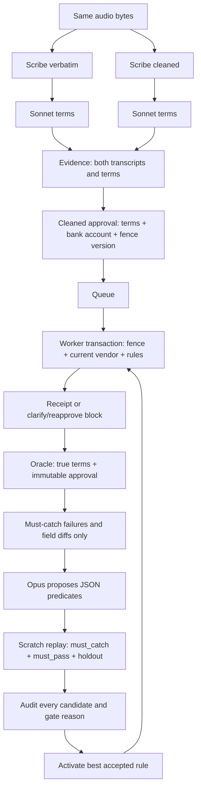

# Payment Approval Fences

A caller can correct an amount mid-sentence, approve a payment, and then have the vendor’s bank account change before the worker commits. What commits must still match what the caller authorized. This Python 3.11 prototype stores both transcript candidates, an immutable approval snapshot, and an actual payment receipt, then evaluates commit-time rules inside a fenced MongoDB transaction. An oracle checks the result against independently labeled intent; a model proposes rule changes that must pass replay gates before activation. Payments here are database receipts, not money transfers. The project started at the MongoDB x Cerebral Valley harness hackathon and is now a portfolio experiment.

## What was actually observed

Six supplied recordings were processed with ElevenLabs Scribe v2 (`no_verbatim=false` and `true`) and independent Claude Sonnet 4.6 extraction. **No extracted money terms diverged between modes.** Cleanup retained the amount and account corrections. All extracted terms matched the speaker-confirmed labels, including spoken account suffixes and “today” resolved to recording date 2026-10-11. This experiment did not reproduce cleanup losing a payment correction.

The baseline still failed when a vendor’s account changed after approval. A live Opus 5.5 proposal learned an account-identity rule that caught that scenario while preserving benign edits. A separate, explicitly synthetic stress suite exercised deliberately lossy transcripts. These are separate results, not additional real Scribe failures.

Scores below are **ok / unsafe_commit / benign_block**; duplicates were zero. Source: [RESULTS.md](RESULTS.md).

| Suite | Set | N | Baseline | Final |
|---|---|---:|---|---|
| Measured recordings + edits | must_catch | 1 | 0 / 1 / 0 | 1 / 0 / 0 |
| Measured recordings + edits | must_pass | 8 | 8 / 0 / 0 | 8 / 0 / 0 |
| Measured suite, synthetic holdouts | holdout | 5 | 2 / 3 / 0 | 3 / 2 / 0 |
| Synthetic stress | must_catch | 4 | 0 / 4 / 0 | 4 / 0 / 0 |
| Synthetic stress | must_pass | 5 | 5 / 0 / 0 | 5 / 0 / 0 |
| Synthetic stress | holdout | 5 | 2 / 3 / 0 | 5 / 0 / 0 |

Measured healing took one iteration; synthetic stress took two. **Two synthetic holdouts remain unsafe in the measured-suite policy.** Its training data contained no transcript divergence from which to learn the clarification rule. The healer’s `healed` status means must-catch failures are resolved, not that all holdouts pass. Six recordings and these small, labeled scenario sets do not establish production error rates or generalization.

## Pipeline and healing loop



The worker atomically claims one pending queue item. One transaction increments the vendor fence, reads current vendor/evidence/intent/rules, and records either an idempotent receipt or a block. Bank-account updates increment the same fence in their transaction, causing conflicting payments to retry and reread coherent state. Fence versions also change for harmless name or memo edits: version equality alone is not an account-identity check. The naive empty-rules baseline intentionally pays the current bank account; the oracle exposes whether that differs from approval.

Rules are deterministic, side-effect-free conjunctions of `eq`/`neq` comparisons between 15 permitted fields in verbatim/cleaned evidence, confirmed terms, approval account/fence version, and current bank account. No generated Python, literal values, or external calls execute inside the transaction. For example:

```json
{"clauses":[{"left":"intent.approved_bank_account","cmp":"eq","right":"vendor.bank_account"}],"on_fail":"reapprove"}
```

The oracle uses independent `true_terms` and `expected: pay | clarify | reapprove`. It checks receipt amount/destination against truth and approval, recognizes requested clarification/reapproval blocks, detects duplicates, and labels ordinary payments that were blocked as `benign_block`. Numeric destinations represent spoken account endings. Ground truth is evaluation data, never an extraction, approval, or payment input.

The proposer sees only `must_catch` failures, their reasons/diffs, current predicate bodies, and vocabulary. `must_pass` and `holdout` scenarios never enter its prompt. Opus 5.5 uses high-effort JSON-schema output, no forced tool choice, and the requested server fallback beta. It may return zero to five candidates. Every candidate receives an audit with per-set before/after counts and rejection reasons. Acceptance requires fewer must-catch failures, zero must-pass benign blocks, and no worse holdouts. Only the best accepted candidate activates; limits are three iterations and eight active rules.

## Run locally without API keys

Install Python 3.11, Docker Compose, and uv:

```sh
uv sync --frozen --python 3.11
docker compose up -d --wait
uv run pytest -q
export MONGODB_URI='mongodb://127.0.0.1:27017/?replicaSet=rs0&directConnection=true'
export ADAPTERS=fixture
uv run python -m db.seed
uv run python pipeline.py demo amount-correction.wav
uv run python oracle.py
uv run python heal.py --proposer fixture
uv run python scoreboard.py
uv run python scoreboard.py --json
```

Fixture mode reads labeled JSON by filename; it needs neither recordings nor API keys. Its intentionally lossy cleaned text is a simulator input. The fixture proposer is an explicit deterministic demo alternative; it does not claim a model was called. Local MongoDB is `mongo:7`, single-node `rs0`, so tests exercise real transactions. Tests use isolated loopback databases, ignore project secret files, and reject remote test URIs. Unit-only checks: `uv run pytest -m 'not integration'`.

## Reproduce live acquisition and Atlas experiments

Keep Atlas and API values in ignored `.env.secrets`. Configuration precedence is process environment, `.env.secrets`, then `.env`; absent/blank URI falls back to local MongoDB. Start from the blank names in `.env.example`. Never commit actual values. If the preceding local commands exported `MONGODB_URI`, unset it to use Atlas from the secret file:

```sh
unset MONGODB_URI
uv run python -m db.ping
uv run python -m db.seed
ADAPTERS=live uv run python -m scripts.measure_audio --reference-date 2026-10-11
uv run python -m scripts.portfolio_experiment --suite measured --output artifacts/experiment.json
uv run python -m scripts.portfolio_experiment --suite fixture --output artifacts/fixture_stress.json
```

Acquisition records both modes from identical bytes and independently extracts each. SHA-256 evidence caching preserves successful partial results. Transcript cache survives extraction-context changes; terms cache includes prompt, schema, model, catalog and reference date. Live errors do not silently fall back to fixtures. `ADAPTERS=fixture|live` selects the pipeline adapter explicitly. Extraction stays on Sonnet 4.6; the proposer uses Opus 5.5. Readback currently returns text, and Raindrop transport remains a stub; local `runs` contains the step logs.

The portfolio runner seeds Atlas first, then creates a fresh owned audit database with empty rules. Gate replays execute the real pipeline/worker/oracle in disposable Atlas scratch databases using frozen measured outputs or explicitly synthetic fixtures; they do not call speech/extraction APIs again. Source demo policy/history is preserved. Each experiment creates a fresh proposal run; `--output` can save an additional export instead of replacing the checked-in reference result. Successful exports validate against [experiment.schema.json](artifacts/experiment.schema.json).

Inspect the saved results **offline**, without MongoDB or API access:

```sh
uv run python scoreboard.py --artifact artifacts/experiment.json
uv run python scoreboard.py --artifact artifacts/fixture_stress.json --json
```

For an account-change demo, enqueue and pay separately:

```sh
ADAPTERS=live RECORDING_REFERENCE_DATE=2026-10-11 uv run python pipeline.py enqueue audio/demo-invoice.wav
# Use outcome.queue_id from the command output.
uv run python scripts/change_vendor_account.py vendor-001 demo-account-updated
uv run python pipeline.py process --queue-id 'queue:YOUR_INTENT_ID'
```

Approval defaults to the cleaned transcript; `--confirm-from verbatim` overrides it. `pipeline.py demo ... --hold` stops after enqueue. Manual `--confirmed-terms` accepts a JSON file with vendor ID, positive integer cents, destination and ISO date. `STATIC_GUARD` defaults off; its optional static destination guard is independent of learned rules. The seed is idempotent and preserves existing vendor accounts and rule history.

## Evidence and repository hygiene

- [RESULTS.md](RESULTS.md): measured findings, separate scoreboards, wall times and returned token usage. Provider responses supplied no invoiced dollar costs; those fields are null. The acquisition log excludes an earlier failed runner attempt and identifies its two cached Scribe outputs.
- [artifacts/live_clips.json](artifacts/live_clips.json): audio hashes, both transcripts/terms, independently confirmed truth and cache provenance.
- [artifacts/experiment.json](artifacts/experiment.json): measured baseline receipts, approvals, every candidate/gate, per-iteration scores and final replay.
- [artifacts/fixture_stress.json](artifacts/fixture_stress.json): separately labeled synthetic stress experiment with live proposals.
- [artifacts/secret_scan.json](artifacts/secret_scan.json): full-history scan scope and reviewed findings; no credential values.
- [LINKEDIN.md](LINKEDIN.md): a draft post based on these measurements.

Secrets, generated egg-info and build output are ignored. CLI errors show sanitized exception type/message; `db.ping` prints only `ok`/`fail` on stdout. No real URI or API key is in an artifact. To repeat the history scan with Gitleaks:

```sh
gitleaks git --log-opts=--all --redact=100 --no-banner .
```

The configuration retains default detectors and narrowly exempts only SHA-256 adapter-cache fingerprint lines in the two acquisition-containing exports. API key fields remain detectable. See the recorded scan for its exact revision and limitations.

[MIT licensed](LICENSE). Repository name remains the original placeholder.
